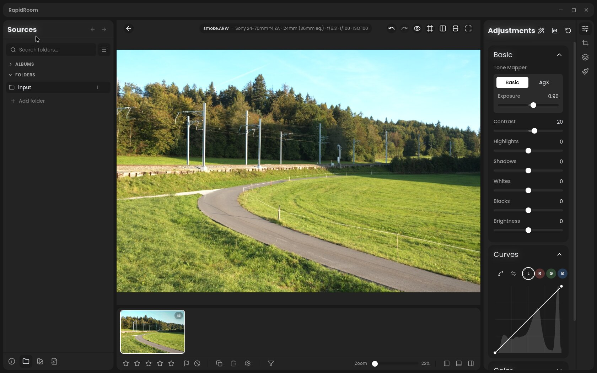
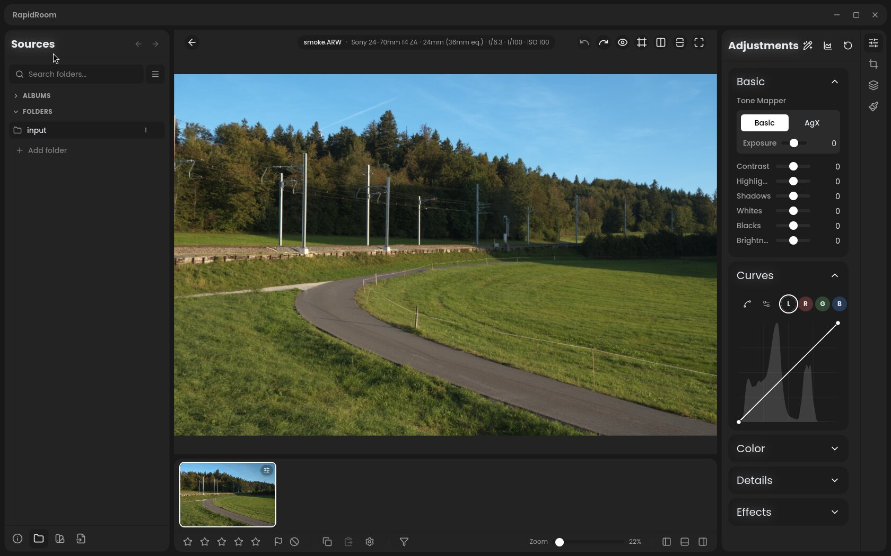
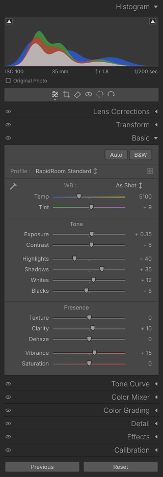

# Lightroom Classic look: layout preset design

Issue #157, and the real goal behind #158. Design only: no code is included or authorized by this document.

A palette-only "Classic" theme was tried for #158 and removed in #190: swapping greys and an accent did not make RapidRoom look like Lightroom. What makes Lightroom Classic recognizable is its component shapes and density: thin slider tracks with pointed handles and right-aligned labels, full-width header bands with right-aligned titles, an inset grey section body, small grey type, black chrome, and almost no accent color. This document proposes an opt-in **Lightroom Classic** layout preset that changes those components through theme tokens and component variants, so it stays maintainable and leaves the default RapidRoom look untouched.

PR #197 (draft) already implements the _structure_ for #157: a Lightroom Classic workspace with Lightroom's section order, the Basic grouping, Library/Develop module buttons, Navigator, Presets, History, Snapshots and the optional keymap. This design is the _visual_ layer for that workspace. The two can land in either order. Section IDs used by MCP and the assistant stay unchanged in both.

## Sources

- The maintainer's Lightroom Classic screenshots from 15 and 29 October 2026: Library, Develop with Basic/Tone Curve/History, Color Mixer, Color Grading/Detail, the History panel, Lens Corrections, Crop, Transform, Masking with the floating mask list, the Presets list, and the Print module. They are private and are not reproduced here. The colors below were sampled from them as pixel values. No Adobe assets, icons or fonts are used.
- Design values already collected on #157 and #158 from pch/rawmakase (MIT), LightCraft (MIT/Apache-2.0) and Redlamp (MPL-2.0). Values only; no code is ported.
- RapidRoom `main` at `1bcb83f0`: `src/utils/themes.ts`, `src/styles.css`, `src/components/ui/{Slider,CollapsibleSection,Button}.tsx`, `src/components/panel/{Filmstrip,PanelSwitcher}.tsx`, `src/components/panel/editor/Waveform.tsx`, `src/components/panel/right/MasksPanel.tsx`.

## RapidRoom today

Native release captures from the native-UI smoke scenario (#134) on a private Weston display at 1680×1050, using the CC0 Sony A7C II test photo (`sony-a7c2-15mp-uncompressed.ARW`, SHA-256 `b808fb96…`). The first image has the default density, after the scenario's Exposure and Contrast edits. The second has Compact density enabled. The engine was built from RapidRoom `main` at `7582cb5f` (engine SHA-256 `7ccb66f9…`); only native-UI harness scripts differ from `1bcb83f0`, so the UI is the same. Library captures are omitted because they show a local folder path.

## 1. Gap table: Lightroom Classic vs RapidRoom main

Measured Lightroom greys are given as hex. RapidRoom values are from the Dark theme and the current components.

| Element                       | Lightroom Classic                                                                                                                                                                                                                                                                                                                                                                                                                                                                         | RapidRoom main                                                                                                                                                                                                                                                                                                                                                                                                                                            | Gap                                                                                                                                    |
| ----------------------------- | ----------------------------------------------------------------------------------------------------------------------------------------------------------------------------------------------------------------------------------------------------------------------------------------------------------------------------------------------------------------------------------------------------------------------------------------------------------------------------------------- | --------------------------------------------------------------------------------------------------------------------------------------------------------------------------------------------------------------------------------------------------------------------------------------------------------------------------------------------------------------------------------------------------------------------------------------------------------- | -------------------------------------------------------------------------------------------------------------------------------------- |
| **Slider**                    | One row: label right-aligned in a fixed column, then the track, then the value right-aligned at the panel edge. Track about 2 px, flat grey with a 1 px darker top edge so it reads as inset. Handle: a small grey pointed shape (pointing down), about 8×10 px. No fill between default and value. A centre tick for signed sliders. Temp, Tint, Vibrance, Saturation and all HSL rows use muted color-gradient tracks. Values in tabular figures with a spaced sign (`+ 0.35`, `− 40`). | Comfortable density: label on its own line above a 6 px rounded track. Compact density (`Slider` `density="compact"`): one row, but the label is left-aligned in a `clamp(4rem,34%,7rem)` column. At the default panel width the compact track is only about 65 px long (see the capture above). 16 px round handle in the accent color (white in Dark). The fill from the default is `accent/25`. A Temp gradient exists (`temperature-gradient-track`). | Track thickness, handle shape and color, right-aligned label column, no fill, gradients on Tint/Vibrance/Saturation/HSL, sign spacing. |
| **Panel and section headers** | A full-width header band (`#292929`, same as the panel), the title right-aligned at about 14 px in a light weight, a disclosure triangle at the far right (▾ open, ◂ closed), an eye on/off toggle at the far left, square corners. The open body is an inset rectangle (`#474747`) with a 1 px dark border. Groups inside a section ("Tone", "Presence") are small centred subheadings separated by 1 px rules.                                                                          | Each section is a rounded card (`--radius-lg: 15px`, `bg-surface`) with the title left-aligned, padding `px-4 py-3`, a rotating chevron, and gaps between cards.                                                                                                                                                                                                                                                                                          | Bands instead of cards, title alignment, disclosure triangle, square corners, inset body color.                                        |
| **Typography**                | Small and quiet: labels about 11 px, values about 11 px, section titles about 14 px light. Weight is regular everywhere, with no bold in panels. Grey hierarchy: label `#b4b4b4`, value `#a0a0a0`, title `#a5a5a5`, secondary `#8a8a8a`. The only white text is the active module and selected toggles.                                                                                                                                                                                   | Labels `text-sm` (14 px) `font-medium`; headings `text-base`. Primary text `#e8eaed`, secondary `#9e9e9e`.                                                                                                                                                                                                                                                                                                                                                | Smaller sizes, regular weight, grey instead of near-white primary text.                                                                |
| **Spacing and density**       | Slider rows about 21 px apart, no card padding, panels run edge to edge with 8 px insets. Subgroups are separated by about 6 px gaps (Exposure/Contrast, then Highlights to Blacks).                                                                                                                                                                                                                                                                                                      | Comfortable rows take about 44 px (label and track on separate lines); compact rows are about 28 px (`h-6` plus `mb-1`). Cards have 16 px padding and gaps between them.                                                                                                                                                                                                                                                                                  | Roughly half the vertical space per control.                                                                                           |
| **Colors**                    | A pure grey ladder: top bar and filmstrip `#000000`, canvas `#222222`, panels and bands `#292929`, histogram `#383838`, section body `#474747`, buttons `#575757`, Library grid `#666666`, grid cell `#878787`, selected cell `#bfbfbf`, selected list row `#b2b2b2` with dark text. The accent is almost unused: no blue fills, and selection is shown in light grey.                                                                                                                    | Dark theme: `#181818` / `#232323` / `#1c1c1c` / `#2b2b2b`, a white accent for handles, active pills and primary buttons.                                                                                                                                                                                                                                                                                                                                  | A different grey ladder; accent fills replaced by grey.                                                                                |
| **Histogram**                 | The first right-panel section (header band "Histogram ▾"), about 100 px tall, `#383838`, overlapping RGB fills, clipping-warning triangles in the top corners that toggle the overlays, an EXIF row below (ISO, focal length, aperture, shutter), and an "Original Photo" checkbox. Dragging in it adjusts Blacks, Shadows, Exposure, Highlights and Whites.                                                                                                                              | `Waveform.tsx`: a rounded card with mode buttons (histogram and other scopes). No EXIF row, no clipping triangles in the plot, no drag-to-adjust.                                                                                                                                                                                                                                                                                                         | Placement, chrome, clipping toggles, EXIF row. Drag-to-adjust is a separate feature.                                                   |
| **Filmstrip**                 | Black background. Grey cells (`#808080`) with large faint index numbers in the top-left corner and thumbnails letterboxed, not cropped. The selected cell is lighter. An info bar above shows view buttons, the source ("Previous Import"), "93 photos / 1 selected / name", and a Filter menu at the right.                                                                                                                                                                              | `Filmstrip.tsx`: rounded cover-cropped thumbnails with a blurred backdrop, badges top-right, in the bottom dock. No index numbers or count line.                                                                                                                                                                                                                                                                                                          | Cell style, letterboxing, index numbers, info bar.                                                                                     |
| **Module switcher**           | Text tabs at the top right of a black top bar: `Library                                                                                                                                                                                                                                                                                                                                                                                                                                   | Develop                                                                                                                                                                                                                                                                                                                                                                                                                                                   | Map                                                                                                                                    | Book                                                                                                                                     | Slideshow                                         | Print | Web`. The active module is white and the rest grey, separated by thin vertical rules. An identity plate is at the top left. | `PanelSwitcher.tsx`: a vertical icon strip with a rounded active pill. Library and the editor are separate views. | Top-bar text tabs (Library and Develop only). The identity plate shows the app name, never a user's name. |
| **Mask list**                 | A floating "Masks" panel over the canvas (top right of the photo): "Create New Mask" with a circled `+`, then one row per mask with a 48 px black/white mask thumbnail and the name. Components nest under the selected mask with Add/Subtract buttons. The footer has "Show Overlay", the overlay color and a menu. Mask adjustments sit in the right panel: "Mask 1 … Reset", Preset/Amount, then Tone/Color/Effects/Detail groups with small disclosure triangles.                     | `MasksPanel.tsx`: containers and sub-mask components in the right panel as rounded cards with type icons. Mask adjustments reuse the global sections.                                                                                                                                                                                                                                                                                                     | Thumbnails, floating placement, Add/Subtract affordance, grouped mask controls.                                                        |
| **History**                   | Left panel, newest first. Each row shows the name at the left and the change (dim) and resulting value at the right (`Saturation  +14  13`). The selected row is light grey with dark text. Import and Export rows include a timestamp.                                                                                                                                                                                                                                                   | No persistent panel. Undo/Redo and a right-click history menu. #306 (PR #475) adopts Lightroom's row format for the planned panel.                                                                                                                                                                                                                                                                                                                        | Panel and row format (covered by #306).                                                                                                |
| **Buttons**                   | Flat grey rectangles (`#575757`), a 1 px darker border, about 2 px radius, light grey text, usually paired at the bottom of a panel (Previous / Reset, Copy… / Paste, Import… / Export…). Mode choices are text toggles separated by thin rules (`Mixer                                                                                                                                                                                                                                   | Point Color`, `Profile                                                                                                                                                                                                                                                                                                                                                                                                                                    | Manual`), with the active one in white.                                                                                                | `Button.tsx`: rounded, accent-filled (white background, black text), `font-semibold`, `py-2 px-4`. Segmented controls are rounded pills. | Flat grey buttons; text toggles instead of pills. |

## 2. Proposal: what the Lightroom Classic preset changes

### Mechanism: tokens and variants, not one-off CSS

1. **Extend theme tokens.** Add the missing semantic tokens to every theme in `src/utils/themes.ts`, with values that reproduce today's look exactly, so the default is unchanged by construction. Map them in `src/styles.css` `@theme` like the existing `--color-*` tokens.
2. **Add an interface style.** Add `uiStyle: 'rapidroom' | 'lightroom'` to the settings, written to `<html data-ui-style="…">`. It selects a second token group for metrics (radii, row heights, type sizes) and a React context that components read to pick a variant. The Lightroom Classic preset sets `uiStyle: 'lightroom'` plus a `lightroom-classic` color theme. With #197 it also selects the Lightroom workspace and keymap (decision 1).
3. **Add component variants.** Each changed component gets one named variant instead of conditionals spread through the app:
   - `Slider` variant `classic`: right-aligned label column, thin inset track, pointed handle, no fill, centre tick, spaced-sign tabular value. It reuses the existing compact one-row layout and the gradient-track hook.
   - `CollapsibleSection` variant `band`: full-width band, right-aligned title, disclosure triangle, eye toggle on the left, square inset body. Section subheadings get a `SectionGroup` component (centred title and rule).
   - `Button` variant `flat`, and a `SegmentedControl` variant `text`.
   - `Histogram` chrome `classic`: header band, clipping triangles, EXIF row, Original Photo checkbox.
   - `Filmstrip` cell `indexed`: grey cells, index numbers, letterboxed thumbnails, info bar.
   - A `ModuleBar`: top-bar text tabs for Library and Develop.
   - Mask list and History rows: the `classic` row styles. The History panel itself comes from #306.

New tokens (default value = today's Dark theme; Lightroom Classic value = measured):

| Token                                                        | Default (Dark)                              | Lightroom Classic                                                       |
| ------------------------------------------------------------ | ------------------------------------------- | ----------------------------------------------------------------------- |
| `--app-chrome` (top bar, filmstrip)                          | `rgb(24,24,24)`                             | `#000000`                                                               |
| `--app-canvas` (editor surround, theme default)              | theme background                            | `#222222`                                                               |
| `--app-panel` (panel and header band)                        | `rgb(28,28,28)`                             | `#292929`                                                               |
| `--app-section-body`                                         | `rgb(28,28,28)`                             | `#474747`                                                               |
| `--app-section-edge`                                         | `rgb(45,45,45)`                             | `#1f1f1f`                                                               |
| `--app-scope-bg` (histogram)                                 | `rgb(28,28,28)`                             | `#383838`                                                               |
| `--app-control` (buttons)                                    | accent                                      | `#575757`                                                               |
| `--app-selection` (rows, cells)                              | `rgb(43,43,43)`                             | `#b2b2b2`, with `--app-selection-text: #202020`                         |
| `--app-text-label` / `--app-text-value` / `--app-text-title` | primary / primary / primary                 | `#c0c0c0` / `#b8b8b8` / `#a5a5a5` (lifted for contrast, see decision 3) |
| `--app-slider-track` / `--app-slider-handle`                 | `rgb(43,43,43)` / accent                    | `#6e6e6e` with a `#2a2a2a` top edge / `#9a9a9a`                         |
| `--ui-radius-section` / `--ui-radius-control`                | `15px` / `8px`                              | `0` / `2px`                                                             |
| `--ui-slider-row` / `--ui-section-header`                    | `44px` comfortable, `28px` compact / `48px` | `21px` / `26px`                                                         |
| `--ui-font-label` / `--ui-font-title`                        | `14px` medium / `16px` medium               | `11px` regular / `14px` light                                           |

### Changed by the preset

Sliders, section headers and bodies, section subgroups, typography sizes and weights, the grey ladder, buttons and mode toggles, the histogram chrome, filmstrip cells, the module bar, mask list rows, and History rows. Combined with #197, it also changes panel order and contents, the left panel set and the keymap.

### Left alone

- **Rendering:** no change to the canvas pipeline, previews, exports or any operator. The full60 regression must stay pixel-identical.
- **The default RapidRoom look:** default token values reproduce it, and a native-UI capture of the default layout before and after must match.
- **Icons and fonts:** Lucide icons and the app font stay. No Adobe icons, fonts or artwork. The identity plate area shows "RapidRoom", never a user's or the maintainer's name.
- **RapidRoom-only panels** (AI, Terminal, Community, Tethering, Export): they inherit the tokens (greys, type, bands, buttons) and keep their layout.
- **Stable IDs:** MCP and assistant section IDs, adjustment keys and sidecar data.
- **Lightroom features RapidRoom lacks** (Map, Book, Slideshow, Print, Web, HDR, Adobe profiles, red-eye): no placeholder tabs or dead buttons.

## 3. Panel order and keymap (from #157)

**Develop, right panel, top to bottom:** Histogram (with clipping toggles); tool strip (Crop, Healing/Spot removal, Red eye, Masking); then collapsible sections:

1. **Basic**:
   - Profile and Treatment;
   - White Balance (eyedropper, WB menu, Temp, Tint);
   - Tone: Exposure, Contrast, Highlights, Shadows, Whites, Blacks;
   - Presence: Texture, Clarity, Dehaze, Vibrance, Saturation.
2. Tone Curve
3. Color Mixer / HSL
4. Color Grading
5. Detail
6. Lens Corrections
7. Transform
8. Effects
9. Calibration

Slider labels, ranges (−100…100, Exposure ±5 EV) and default positions are as Lightroom shows them. Brightness has no Lightroom counterpart and moves to an "Extra" group.

**Develop, left panel:** Navigator, Presets, Snapshots, History, Collections. **Bottom:** filmstrip. **Top:** module switch (Library and Develop at least).

**Behaviour:**

- Solo mode: opening one section collapses the others.
- Double-click a label to reset it.
- Alt-drag shows the clipping preview where RapidRoom has one.

**Library:** left panel Catalog, Folders, Collections; right panel Quick Develop, Keywording, Metadata; a grid with Lightroom-like cell information.

**Optional keymap** (Lightroom Classic defaults): G, D, E, R, K, P/X/U, 0–5, `\`, Y, J, L, Ctrl+Shift+C/V…. PR #197 implements these with custom bindings taking precedence.

## 4. Mockup: Develop right panel, Basic open

An SVG drawn from the measured colors and the metrics above, at 320 px wide (1×). The histogram is synthetic. The values are illustrative, and the profile name is RapidRoom's own.

## 5. Decisions for the maintainer

1. **One preset or two switches?** Should "Lightroom Classic" select both the look and #197's layout and keymap as one workspace, or should the look be an independent Settings → Appearance choice? Recommendation: one workspace preset, with the keymap still separately switchable as in #197.
2. **Order of work for #197.** #197 has been a draft since 11 October and needs a refresh onto `main`. Should it be refreshed and reviewed first, with this look built on top, or should the look land first (it touches only presentation)? Recommendation: refresh #197 first, so the look is built on Lightroom's structure.
3. **Fidelity vs contrast.** Lightroom's measured value text (`#a0a0a0` on `#474747`) is 3.55:1 and its labels (`#b4b4b4`) are 4.48:1, both below WCAG AA (4.5:1) for small text. The proposal lifts them to `#b8b8b8` (4.68:1) and `#c0c0c0` (5.11:1), which is barely visible as a difference. Exact Lightroom greys or the lifted values?
4. **Slider handle.** A pointed Lightroom-like handle (as in the mockup), or a small round grey handle that keeps RapidRoom's identity?
5. **Mask list.** Move it to a floating "Masks" panel over the canvas as Lightroom does, or restyle the existing right-panel list (thumbnails, Add/Subtract) and keep it docked? Recommendation: keep it docked for the first version.
6. **Library grid and filmstrip.** Grey cells with large index numbers and letterboxed thumbnails, as in Lightroom, or only the darker colors?
7. **Scope of the first implementation PR.** Recommendation: tokens plus the `Slider`, `CollapsibleSection` and `Button` variants first, since they cover most of Develop; then the histogram, module bar and filmstrip; then the mask list, with History through #306. Each PR needs native-UI captures of the default look (unchanged) and the Lightroom look, compared side by side by a human with Lightroom.
