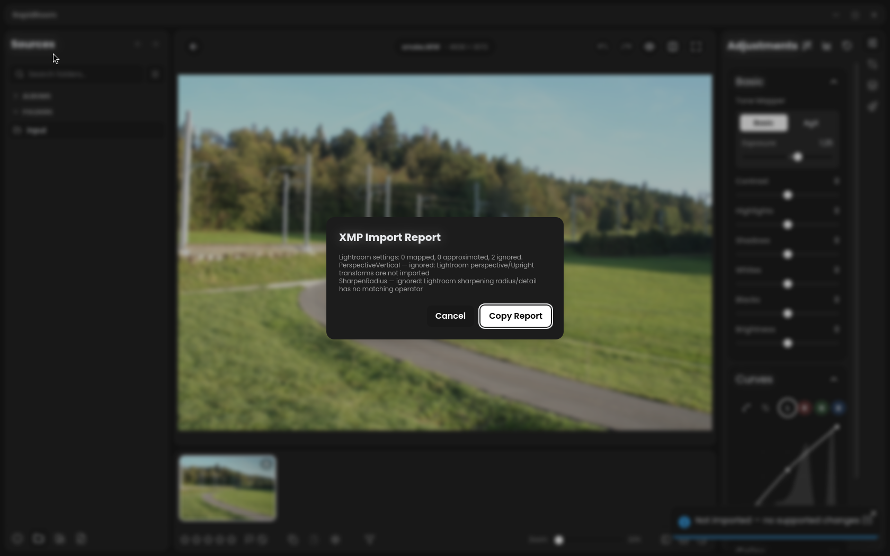

# CRS per-setting import report validation

Product source tested: `a11de2416040ccf0f74d5685cf8aecc15159b594`.

The capture uses a CC0 corpus raw and a synthetic packet containing
`PerspectiveVertical` and `SharpenRadius`. The native dialog identifies both
ignored settings and their reasons, omits source paths and values, and offers
Copy Report. The harness waits for the dialog transition before capturing it.
No Adobe sample, private photograph or splash asset is included.

- Locked release build, formatting, strict all-target/all-feature Clippy, Rust
  library tests and Vitest passed on the tested product source.
- Local default full60: **60/60 pixel-exact** against the blessed reference.
- Linux WebKitGTK native smoke: **12 steps passed**, including the public import
  menu, namespace/subject scoping, curve import, this unsupported-only report,
  unchanged native state and pixels, DOCTYPE refusal, exact Undo, JPEG export
  and clean exit. The settled-capture rerun also passed all 12 steps.
- Later evidence/harness changes preserve the tested product files. Main refreshes
  retain these local checks only when the owned source files are unchanged.

Physical Windows/macOS and a human Lightroom import are not tested here.
