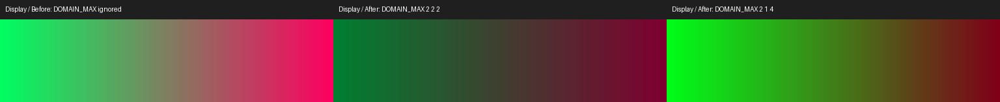
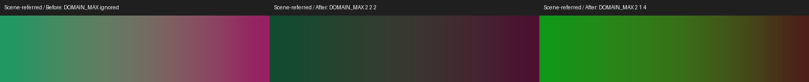

# Cube LUT input-domain validation

Product source tested: `2ca480d548213ea8271152cf5b3a87480603308f`.
Inputs are a synthetic RGB gradient and identity cubes; no photographs or Adobe
files are included.

Each panel compares the old engine ignoring domain headers with the corrected
`DOMAIN_MAX 2 2 2` and asymmetric `DOMAIN_MAX 2 1 4` results. All panels use
`DOMAIN_MIN 0 0 0` and 100% LUT intensity. The expected darkening and channel
changes show that input coordinates use the authored bounds once.

[Actual TIFF export checks](export-results.json) cover display and scene LUTs at
both 8- and 16-bit output. For every path, the old ignored-domain result exactly
matches the fixed engine's unit-domain control. Non-unit domains intentionally
change the output; temporary TIFFs were deleted after comparison. Code deltas
are measured on the decoded 16-bit scale, including scaled 8-bit exports.

[Production GPU sampling probe](gpu-probe.json) passed one test on the actual
Intel Vulkan adapter. It executes the production WGSL coordinate/tetrahedral
sampler for midpoint lookup, negative/asymmetric ranges, clipping, intensity
0/50/100 and the unit-domain bypass. It is not a duplicate CPU sampler.

Formatting, strict Clippy, Rust library tests, Vitest and a locked release passed
on the tested source. Local default full60 is **60/60 pixel-exact**. A refreshed
engine build/full60 and exact-head hosted CI/review remain required after main
integration. Only non-unit `.cube` LUTs intentionally change rendered output;
human approval is required before merge. Physical Windows/macOS are untested.
