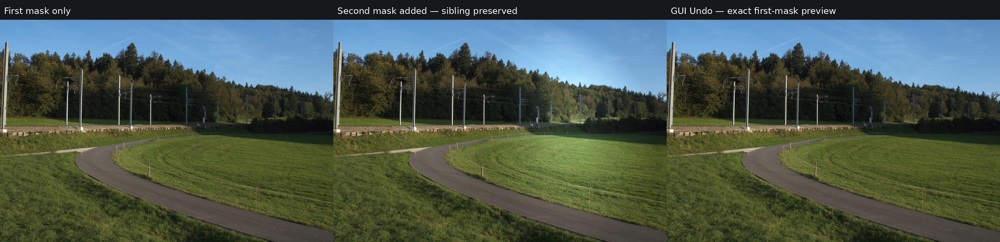

# MCP mask tools — #150 / PR 212

Measured application source: `1d061908d9e3e2ba6e7c956d9f778c67ca9973c2`, based on main `f7805a7e` including PR 211.
Harness source: `d5f8a08346958d2a2b193fa5a50d1befbd345f62` (Python-only reload selector correction; compiled application objects unchanged).
No reference recording or re-bless was performed.

These are exact preview-region crops from the real native application on the
public CC0 Sony fixture described in [fixture.json](fixture.json). First-mask and
GUI Undo pixels are identical; adding the second mask changes the preview while
the first container stays exactly unchanged. The crops remove local application
paths; the comparison adds only labels outside the images.

[Native results](native.json) cover actual installed Claude's single-mask add,
compact replies, partial HSL defaults, GUI Undo, shared Redo, sparse nested patch,
autosave and fresh frontend sidecar reload, target-only remove and invalid/no-op
refusals. The separate combined-PR211 phase verifies bounded name echoes,
intentional projected rename and opaque-ID boundaries without model requests.

[Full60](full60.json) records 60/60 pixel-exact comparisons against the frozen int7
reference on the same environment. [Gates](gates.json) pins production/native
binaries, locked builds, fmt, strict all-feature Clippy, Rust tests, full Vitest,
changed-file format/lint, generated schema/status checks and corpus/reference guards.
Source probes audit all 16 typed parameter schemas and exhausted-budget echo
round trips. Native interaction uses radial masks; it does not exercise every
component through the GUI or invoke AI mask generation. #120's remaining AI,
preview-coordinate, virtual-copy, preset and library work is not closed.

[Inspection](inspection.json) records agent visual inspection; it is not Josh's
visual approval. Application test logs and full screenshots remain local because
they contain operational paths; only the allowlisted summary and CC0 crops ship.
