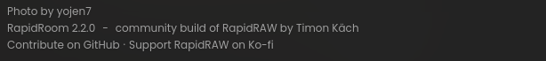

# Start-screen upstream credit validation

Product source tested: `3728317a39dd4d453ad800113c197338be6daa3a`.

This is an unscaled caption-only crop from the native WebKitGTK application.
It shows `RapidRoom 2.2.0 – community build of RapidRAW by Timon Käch`, without
an upstream semantic version. The protected splash photograph is excluded.
The capture waits for compositor paint, then the native smoke continues.

- Vitest, frontend build, formatting and generated status checks passed.
- Changed-file ESLint has no new findings against the base; MainLibrary's four
  existing explicit-any errors and four warnings are unchanged. The changed
  utility/test files pass.
- Locked native release and the eight-step Linux smoke passed: visible startup
  credit and RapidRoom version, library thumbnail/preview, edit, exact Undo,
  Compact persistence, JPEG export and clean exit.
- The evidence commit does not change the tested application source. Current-head
  hosted CI and regression remain required before merge.

Physical Windows/macOS apps and a human native-app check are not covered.
